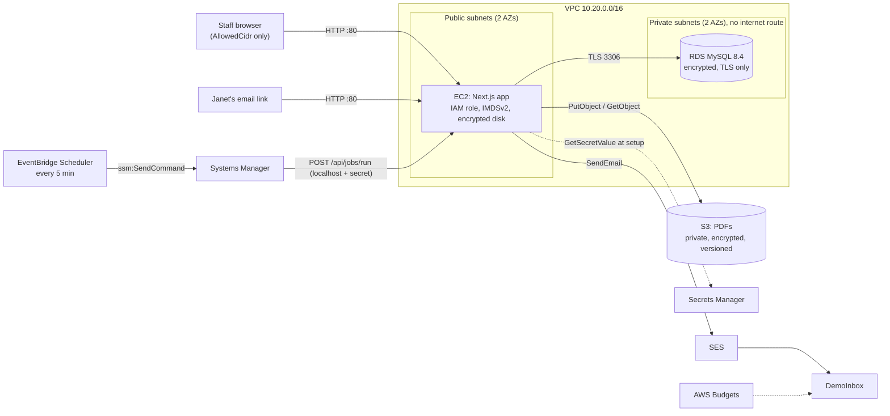

# Architecture on AWS

How OrderFlow runs on AWS, why it is built this way, and how it lines up with the six pillars of the AWS Well-Architected Framework. The template is [infra/orderflow.yaml](../infra/orderflow.yaml); how to deploy it is in [AWS_DEPLOY.md](AWS_DEPLOY.md).

## The picture

**One request, end to end (story 3):** Priya submits an SPR → the app writes the SPR and three scheduled reminder rows to RDS → the Notifier writes the approval request to the Outbox table and SES emails it → Janet clicks the signed link, which opens the app → her decision is written to RDS and the remaining reminders are cancelled. Every 5 minutes EventBridge Scheduler asks Systems Manager to run `/usr/local/bin/orderflow-run-jobs` on the server, which calls `POST /api/jobs/run` on localhost; any reminder that has come due is emailed.

**Story 4:** a proof of payment is uploaded or imported → the PDF goes to S3, the document row to RDS → Finance confirms the payment → the warehouse notice is written to the Outbox and emailed through SES. Payment reminders are drafts until Finance clicks Send, and only then emailed.

**What did not change:** the rules (`src/domain`), the use cases (`src/services`) and the pages. AWS sits behind the same interfaces the local version uses (`FileStore`, `Notifier`, the Prisma client), chosen by settings in `.env`. The laptop version and the 600-odd tests run without AWS.

## Why these services

| Need | Choice | Why not something else |
|---|---|---|
| Run the Next.js app | One EC2 instance (t3.small) | Simplest thing a student team can understand, log in to and debug. App Runner or ECS would need a container image pipeline; Lambda does not suit a long-running Next.js server with server actions. |
| Persistent data | RDS for MySQL | The schema was written portable (money as text, no enums); the deck names RDS MySQL; managed backups and patching. |
| PDFs | S3 | Durable, cheap, private; the app already stored files by content hash. |
| Email | SES | Pay per message, no mail server to run, works from an IAM role. |
| Reminders on time | EventBridge Scheduler → Systems Manager Run Command | No extra Lambda and no network path to the jobs endpoint from outside: the command runs on the server itself. |
| Secrets | Secrets Manager (RDS-managed password) | No password in the template, in Git, or in the CI system. |
| Infrastructure as code | CloudFormation (YAML) | The team's choice; no extra tool to install; checked by `cfn-lint` in CI. |

## The six Well-Architected pillars

| Pillar | What we do | What a production version would add |
|---|---|---|
| **Operational excellence** | Everything is code: one CloudFormation template, server setup in a versioned script ([infra/ec2/setup.sh](../infra/ec2/setup.sh)), CI on every push (typecheck, lint, about 600 tests, golden test, end-to-end tests, `cfn-lint`), deploy from GitHub after all checks pass. The stack only completes when the app answers (CreationPolicy). Logs in `journalctl` and the setup log; every scheduled run in Run Command history; the audit log and Outbox show what the app did and whether each email was accepted. | CloudWatch Logs agent and dashboards; alarms on errors; runbooks. |
| **Security** | No AWS keys anywhere: the server uses an IAM role with only the S3, SES and Secrets Manager actions it needs; GitHub deploys through a short-lived OIDC role. Database in private subnets with no internet route, reachable only from the app's security group, TLS required (`require_secure_transport`) and the certificate checked. S3: all public access blocked, non-TLS requests denied, encrypted. EBS and RDS encrypted. IMDSv2 required. No SSH: Session Manager only. Only HTTP (port 80) open, and only to `AllowedCidr`. Approval links signed, single-use and expiring (story 3). SES sends only to the verified demo inbox. | Real sign-in with Cognito (the persona picker is not authentication), HTTPS through a load balancer with an ACM certificate, AWS WAF, GuardDuty. |
| **Reliability** | RDS automated backups (`DbBackupRetentionDays`: 1 day on the AWS free plan, 7 or more on a paid plan) and a snapshot on delete; S3 versioning (deleted or overwritten PDFs recoverable for 30 days); the app restarts by itself (systemd) and the server is moved to healthy hardware by a CloudWatch recovery alarm; a fixed Elastic IP keeps links working after a restart; an email that SES refuses is recorded, never lost, and does not stop the work that sent it; the database and subnets span two AZs, ready for Multi-AZ. | `DbMultiAz=true` (one parameter); two app servers behind a load balancer in an Auto Scaling group. |
| **Performance efficiency** | Sized to the load: a few staff and tens of orders a day. Burstable instances (t3, t4g Graviton for RDS), gp3 storage, connection pool of 5. The heavy work (reading PDFs) happens once per document and the result is stored. | Measure with CloudWatch before resizing; CloudFront for static files. |
| **Cost optimization** | The cheapest pieces that do the job: one small server, a single-AZ micro database, no NAT gateway (the database needs no internet), no load balancer, pay-per-use S3 and SES, Scheduler instead of an always-on worker. A monthly AWS Budget emails at 80% of actual and 100% forecast spend. Old S3 versions expire after 30 days. Server and database can be stopped between demos ([AWS_DEPLOY.md](AWS_DEPLOY.md), "Saving money"). | Savings Plans or reserved capacity once usage is steady; Instance Scheduler to stop outside office hours. |
| **Sustainability** | Graviton (ARM) database instance, small instance sizes, nothing running that is not needed, PDFs not duplicated (stored by content hash), old versions cleaned up. | Graviton for the app server too; stop non-production stacks outside office hours. |

## Known limits of this version

- **One app server.** If it is rebuilt, the demo data lives on in RDS and S3, but the `data/navision` files (the Navision stand-in) and the export folder are on its disk. A real Navision connection replaces those ([NAVISION_ADAPTER.md](NAVISION_ADAPTER.md)).
- **HTTP, not HTTPS**, and no real login. Acceptable for a demo limited to one IP address; not for real users.
- **SES sandbox:** every email goes to `DemoInbox`. Leaving the sandbox needs a request to AWS and real recipient addresses.
- **Only stories 3 and 4 use the AWS services directly** (all stories run on the AWS server and database). Textract and Bedrock for reading documents, Cognito for sign-in, and SNS for a team channel are next ([AWS_MAPPING.md](AWS_MAPPING.md)).
- **Not yet deployed by the build.** The template passes `cfn-lint`, and the app was tested against MySQL 8.4 with TLS required (Docker), with S3 and SES through fake clients. The first real deployment is the remaining check.
